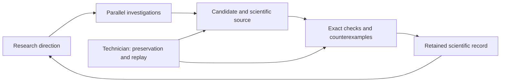

# Gömböc research

**AI-assisted constructions, searches and open problems** · Oleksandr H.

This repository makes the scientific record of an AI-assisted geometry investigation available for inspection: explicit polyhedra, exact verification programs, search methods, numerical experiments and the reports behind them. The central question is whether a homogeneous convex polyhedron can have just one stable and one unstable equilibrium at its own volume centroid.


**C622:** 176 vertices · 311 true edges · 137 maximal facets. The supplied exact checks return one stable equilibrium, one unstable equilibrium, no saddle equilibria and no additional weak equilibria. Blue marks the stable face; red marks the unstable vertex. These are views of the rational construction; the rounded mesh is not a certified printable model.

## Reproduce C622

Python 3.11 or newer; standard library only. From the repository root:

```sh
mkdir -p _work
python3 -B -S C622/VERIFY.py ../_work/c622-proof
```

Use a fresh output directory and keep assertions enabled. Expected final status: `LOCAL_C622_ENDPOINT_TWO_EXACT_AUDITS_AND_THIRD_MASS_PASS`. The check takes about 20 seconds on the preparation machine. It reruns the supplied exact algorithms; it is not external peer review or proof-assistant certification. [Exact definition, source and limitations →](C622/README.md)

## Explore the research

**[Search the scientific catalog](https://ohresearchresults.github.io/gomboc-research/)**

| Material | Start here |
| --- | --- |
| Featured finite bodies, counts and exact-check scope | [Construction gallery](catalog/constructions.md) |
| Earlier constructions, methods and unsuccessful directions | [Scientific collections](catalog/README.md) |
| 898 saved AI scientific reports, in their original language | [Report index](reports/README.md) |
| 1,101 selected source capsules and proof records | [Scientific materials](materials/README.md) |
| 174 recorded research branches | [Branch map and linked reports](catalog/branches.md) |
| Dated constructions and verification checkpoints | [Scientific chronology](catalog/chronology.md) |
| 158,763 selected file paths; 2.81 GB before compression | [Download numerical collections](catalog/downloads.md) |
| What is verified, provisional, missing or omitted | [Coverage and evidence limits](catalog/coverage.md) |

The retained C<500 search remains open. The Minimum C≥34 bound is a working claim, with a consolidated publication proof outstanding. Earlier “current best” labels belong to their historical checkpoints. Lower-complexity nonwinners are retained because their failures and methods are useful.

To add the large datasets to a checkout:

```sh
python3 tools/fetch_data.py all
```

Each ordinary archive is listed with its checksum; the downloader verifies every file before accepting it. C622 needs none of these additional downloads.

## How the research was organized

The workflow used a coordinator and parallel copies of the research model. Workers investigated separate mathematical directions, returned source-bearing results and shared retained scientific artifacts. The number of workers and the models changed during the investigation. A Kanban view showed working, idle and failed assignments; a research map kept directions, branch memory and source links accessible across agent changes.

A separate AI technician monitored the workflow, recovered completed outputs, preserved sources and replayed checks. Human decisions shaped the environment, verification requirements, model changes and when to pause a stalled search. The difficult engineering task was maintaining a useful search-and-check loop with limited continuous human supervision. This archive documents that particular investigation; it does not establish that the same outcome follows for every user or problem.

Candidate discovery and acceptance were separate steps. A numerical hint or an AI assertion was not enough: the intended acceptance path required a finite construction, its own uniform-volume centroid, true polyhedral incidence and exact equilibrium checks. The archive also preserves failed candidates, incomplete claims and known collection gaps. The management application's implementation is private; the released mathematical code and C622 reproduction are separate from it.



## Related work and citation

Tancredi Schettini Gherardini’s [independent construction and verification repository](https://github.com/Tancredi-Schettini-Gherardini/certified_gomboc) is a relevant comparison. Its [paper](https://arxiv.org/abs/2609.07827) asks for an example with fewer than 1,000 faces; the C622 construction has 137 maximal facets. This numerical comparison does not assert minimality or establish publication priority.

The manuscript about access to AI-assisted research is still in preparation and is **not included**. Use [CITATION.cff](CITATION.cff) to cite this archive. [Rights and attribution](RIGHTS.md) record the current reuse status.
