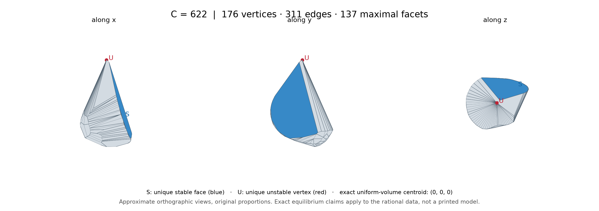
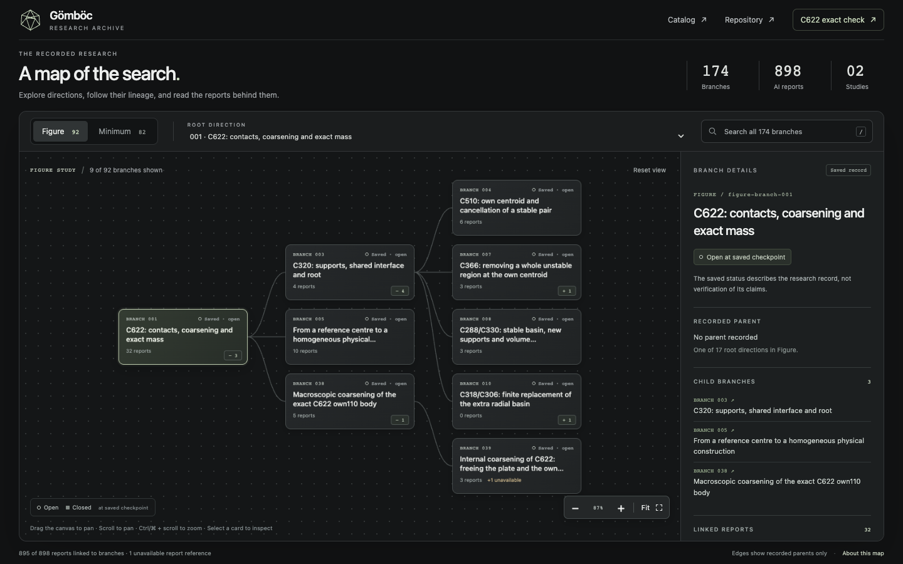
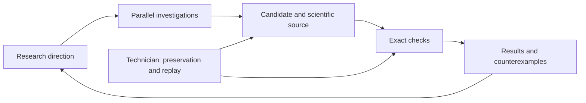

# Gömböc research

**An explicit polyhedral gömböc with 137 faces, and the record of the AI-assisted search that found it**

A gömböc is a convex body of uniform density with exactly two equilibria on a horizontal plane: one stable and one unstable. It has a single stable resting pose. Várkonyi and Domokos [proved in 2006](https://www.gomboc.eu/docs/100.pdf) that such bodies exist; their example has a smooth curved surface. This repository is about the same question for polyhedra, where every face, edge and vertex is a possible resting point and the centre of mass moves whenever the shape is changed.

## Result

**C622 is an explicit convex polyhedron with 176 vertices, 311 edges and 137 faces which, as a solid of uniform density, has exactly one stable and one unstable equilibrium.** It rests on one face, balances on one vertex, and has no other equilibrium, including borderline (degenerate) ones.



Blue marks the stable face; red marks the unstable vertex.

- All vertex coordinates are rational numbers. The equilibria are counted in exact arithmetic about the solid's own centre of mass, by two independent programs that must produce identical reports.
- The name follows the size measure used throughout: C = V + E + F − 2 = 2E, so 176 + 311 + 137 − 2 = 622. Coplanar faces are merged before counting.
- Not claimed: that 137 faces is the minimum, or that a printed copy would behave this way. Rounded coordinates can change the equilibria; see [precision notes](C622/README.md#precision-and-printing).

## Check it yourself

Python 3.11 or newer; no packages to install. From the repository root:

```sh
python3 -B -S C622/VERIFY.py fresh-proof
```

The run takes about 20 seconds and ends with `LOCAL_C622_ENDPOINT_TWO_EXACT_AUDITS_AND_THIRD_MASS_PASS`. Results are written to `C622/fresh-proof/`. The program refuses to overwrite an earlier run, so delete that folder or give another name to run it again. [What is checked, and the exact definition of the body](C622/README.md).

## Research branches

[](https://ohresearchresults.github.io/gomboc-research/research-map.html)

[Explore the interactive map](https://ohresearchresults.github.io/gomboc-research/research-map.html): 92 construction-search branches and 82 minimum-search branches. Follow a direction to its parent, subbranches and saved reports. The links reproduce the recorded research tree; open and closed labels describe its saved checkpoints.

## Explore the research

**[Search the scientific catalog](https://ohresearchresults.github.io/gomboc-research/)**

| Material | Start here |
| --- | --- |
| Polyhedra, their sizes and verification results | [Construction gallery](catalog/constructions.md) |
| Earlier constructions, methods and unsuccessful directions | [Scientific collections](catalog/README.md) |
| 898 AI research reports | [Report index](reports/README.md) |
| 1,101 source notes and proof drafts | [Scientific materials](materials/README.md) |
| 174 recorded research branches | [Interactive map](https://ohresearchresults.github.io/gomboc-research/research-map.html) · [Branch index](catalog/branches.md) |
| Dated constructions and verification checkpoints | [Scientific chronology](catalog/chronology.md) |
| 158,763 scientific files; 2.81 GB before compression | [Download numerical collections](catalog/downloads.md) |
| Verification status and missing material | [Coverage](catalog/coverage.md) |

To add the large datasets to a checkout:

```sh
python3 tools/fetch_data.py all
```

The downloader uses the [Zenodo dataset archive](https://doi.org/10.5281/zenodo.23307925) and verifies archive and file hashes. Use `--source github` for the identical GitHub copies. C622 needs no additional downloads.

The reports and notes are working records written during the search, with their own shorthand. [Notation](catalog/README.md#notation) explains the recurring terms.

## How the research was organized

A coordinator and parallel AI workers investigated different mathematical directions and shared results with their source code. A Kanban view tracked assignments, and a research map linked each direction to its reports. Models and worker counts changed during the search.

A separate AI technician monitored the workflow, collected completed outputs, saved sources and reran checks. The human role centered on building the environment, setting verification requirements, choosing models and deciding when to pause the search.

A candidate was accepted only with explicit coordinates, its exact centre of mass, its faces and edges after merging coplanar faces, and exact equilibrium counts. Failed candidates and incomplete arguments are recorded alongside successful constructions.



## Related work and citation

Tancredi Schettini Gherardini’s [paper](https://arxiv.org/abs/2609.07827) and [repository](https://github.com/Tancredi-Schettini-Gherardini/certified_gomboc) present an independent construction. The paper asks for an example with fewer than 1,000 faces; C622 has 137.

[Code and records DOI](https://doi.org/10.5281/zenodo.23307702) · [Datasets DOI](https://doi.org/10.5281/zenodo.23307925) · [Citation](CITATION.cff) · [License](RIGHTS.md): code under MIT, data and text under CC BY 4.0
