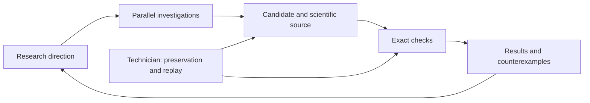

# Gömböc research

**AI-assisted constructions, searches and open problems** · Oleksandr H.

Constructions, code and experimental data from an AI-assisted search for a homogeneous convex polyhedron with exactly one stable and one unstable equilibrium at its own volume centroid.


**C622:** 176 vertices · 311 true edges · 137 maximal facets. Exact checks return one stable equilibrium, one unstable equilibrium and no saddle or additional weak equilibria. Blue marks the stable face; red marks the unstable vertex.

## Reproduce C622

Python 3.11 or newer; standard library only. From the repository root:

```sh
mkdir -p _work
python3 -B -S C622/VERIFY.py ../_work/c622-proof
```

Use a fresh output directory and keep assertions enabled. [Exact definition, verification details and mesh precision](C622/README.md).

## Explore the research

**[Search the scientific catalog](https://ohresearchresults.github.io/gomboc-research/)**

| Material | Start here |
| --- | --- |
| Polyhedra, their sizes and verification results | [Construction gallery](catalog/constructions.md) |
| Earlier constructions, methods and unsuccessful directions | [Scientific collections](catalog/README.md) |
| 898 AI research reports | [Report index](reports/README.md) |
| 1,101 source notes and proof drafts | [Scientific materials](materials/README.md) |
| 174 recorded research branches | [Branch map and linked reports](catalog/branches.md) |
| Dated constructions and verification checkpoints | [Scientific chronology](catalog/chronology.md) |
| 158,763 scientific files; 2.81 GB before compression | [Download numerical collections](catalog/downloads.md) |
| Verification status and missing material | [Coverage](catalog/coverage.md) |

To add the large datasets to a checkout:

```sh
python3 tools/fetch_data.py all
```

The downloader verifies archive and file hashes. C622 needs no additional downloads.

## How the research was organized

A coordinator and parallel AI workers investigated different mathematical directions and shared results with their source code. A Kanban view tracked assignments, and a research map linked each direction to its reports. Models and worker counts changed during the search.

A separate AI technician monitored the workflow, collected completed outputs, saved sources and reran checks. The human role centered on building the environment, setting verification requirements, choosing models and deciding when to pause the search.

Candidate verification required an explicit finite construction, its uniform-volume centroid, its true edges and maximal facets, and exact equilibrium counts. Failed candidates and incomplete arguments are recorded alongside successful constructions.



## Related work and citation

Tancredi Schettini Gherardini’s [paper](https://arxiv.org/abs/2609.07827) and [repository](https://github.com/Tancredi-Schettini-Gherardini/certified_gomboc) present an independent construction. The paper asks for an example with fewer than 1,000 faces; C622 has 137 maximal facets.

[Citation](CITATION.cff) · [Rights and attribution](RIGHTS.md)
