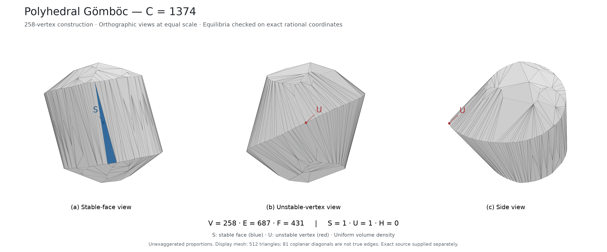
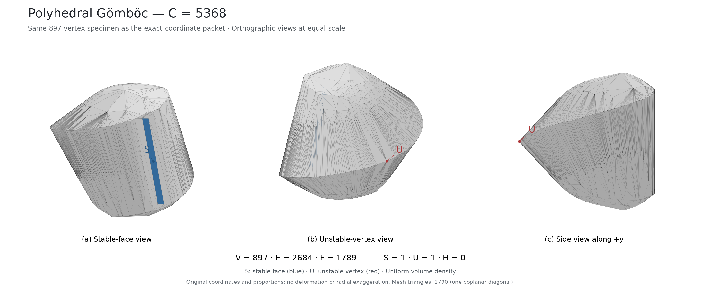
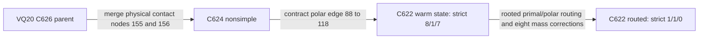

# Constructions and exact checks

These are distinct finite polyhedra, not a claim that every row is derived from the preceding row. Complexity is (C=V+E+F-2=2E), using true edges and maximal facets. All equilibrium claims refer to the filled solid's own uniform-volume centroid.

| Construction | V / E / F | Evidence in this release | Scientific package |
| --- | --- | --- | --- |
| C622, VQ20 routed endpoint | 176 / 311 / 137 | Supplied exact endpoint algorithms freshly rerun; strict 1/1/0, weak 0/0/0 | [C622](../C622/README.md) |
| C632, BQ13 winner | 180 / 316 / 138 | Historical local exact replay; distinct from the C632 nonwinner | [BQ13 source](../results/history/figure/gomboc-C632-BQ13-2026-09-10/BQ13/) |
| C634, SOC construction | 182 / 317 / 137 | Historical local exact replay; other cases retain their own status | [Finite source](../results/history/figure/gomboc-C634-2026-09-10/source-only/) |
| C648, rebuilt R7/R12 | 189 / 324 / 137 | Source-authenticated agent exact claims; the inspected preservation pass did not rerun the mathematics | [Rebuilt family](../results/history/figure/gomboc-C648-REBUILT-2026-09-09/) |
| C746 | 235 / 373 / 140 | Historical local supplied exact replay, strict 1/1/0 and weak 0/0/0 | [C746](../results/history/figure/gomboc-C746-2026-09-09/) |
| C752 | 237 / 376 / 141 | Historical local supplied exact replay, strict 1/1/0 and weak 0/0/0 | [C752](../results/history/figure/gomboc-C752-2026-09-09/) |
| C1370 | 258 / 685 / 429 | Historical supplied exact construction and viewing-mesh diagnostic | [C1370](../results/history/figure/domokos-C1370-diagnostic-2026-09-08/gomboc-1370/) |
| C1374 | 258 / 687 / 431 | Historical local two-implementation exact replay | [C1374](../results/history/figure/domokos-C1374-2026-09-07/) |
| C5368 | 897 / 2684 / 1789 | Historical exact rational specimen and direct verifier | [897-vertex source](../results/history/figure/langi-review-2026-09-05/shortcut897-source/) |

The [historical-constructions download](downloads.md) adds the large geometry and audit files to their corresponding source directories. A Git-only checkout is sufficient for C622; some historical packages require that data download. Use a working copy for historical replays, since several original drivers write beside their inputs.

## Views of earlier specimens

C1374 has 431 maximal facets. This independently generated viewing figure depicts the retained rational construction; it does not certify a rounded physical print.

C5368 is the 897-vertex specimen. The separate 1,213-vertex body in the same historical collection is a different construction.

## A documented local construction chain

The C622 source records this specific sequence. The separate S8 C624 benchmark is not its parent.

The retained finite generators and [protocols](../C622/source/PROTOCOLS.json) support these transitions. They do not establish that no equilibria are born along every point of the continuous numerical interpolation. [Chronology](chronology.md) records the wider sequence of discoveries and local checks without turning it into an unsupported genealogy.
